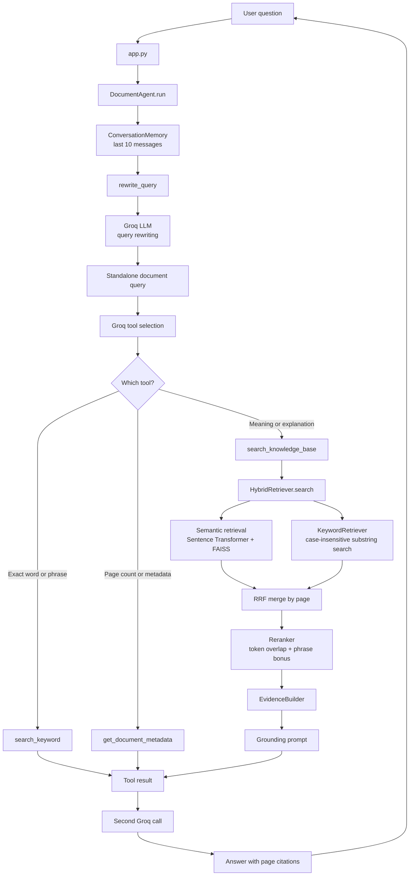
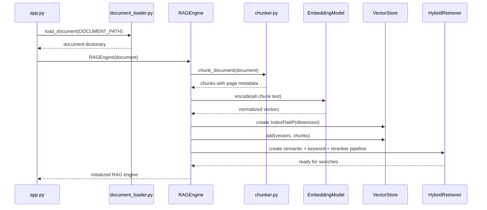
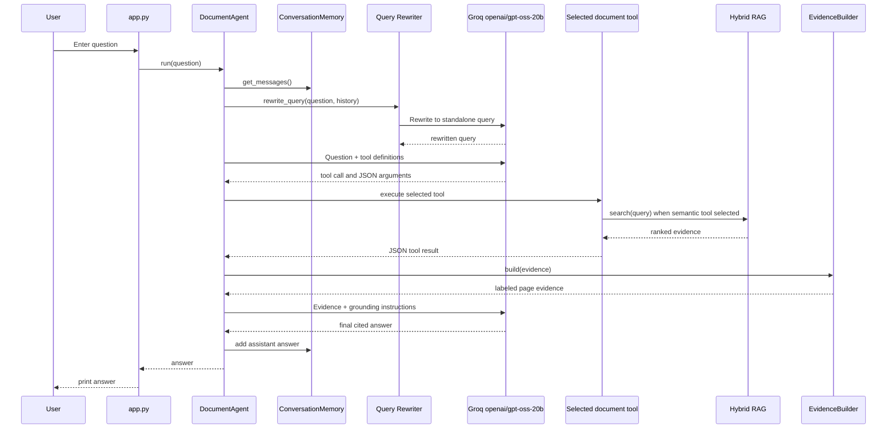

# Document Analysis Agent

This project is a document-question-answering agent built with Python. It combines:

- PDF text extraction with `pypdf`
- Character-based document chunking
- Semantic embeddings with Sentence Transformers
- Exact vector search with FAISS
- Exact keyword search with regular expressions
- Hybrid retrieval and Reciprocal Rank Fusion (RRF)
- Lexical reranking
- Query rewriting for follow-up questions
- Conversation memory
- Groq tool calling
- Evidence-based final answer generation with page citations

The current application is an **agentic RAG system**. The language model does not directly answer every question from memory. It first selects an appropriate document tool, the tool gathers evidence, and the model then writes an answer constrained by that evidence.

## 1. Current End-to-End Architecture



## 2. Startup and Index-Building Flow

The expensive preparation happens once when the application starts. The resulting `RAGEngine` is reused for every user question.



## 3. One Question Flow



## 4. The Active Entry Point: `app.py`

The current `app.py` performs these steps:

1. Defines the input PDF path:

   ```python
   DOCUMENT_PATH = "documents/enterprise_document_analysis_test.pdf"
   ```
2. Calls `load_document(DOCUMENT_PATH)`.
3. Prints the number of loaded pages.
4. Creates `RAGEngine(document)`, which builds the retrieval index.
5. Creates `DocumentAgent(document, rag)`.
6. Repeatedly prompts the user with `You:`.
7. Stops when the user enters `exit` or `quit`.
8. Sends every other question to `agent.run(question)`.
9. Prints the returned answer.

The current app does **not** directly call `ask_llm` for every question. It delegates question handling to `DocumentAgent`, which can select tools and perform multi-stage reasoning.

## 5. Document Loading

File: `agent/document_loader.py`

`load_document(file_path)` checks the file extension:

- `.pdf`: uses `pypdf.PdfReader` and extracts each page.
- `.txt`: reads UTF-8 text.
- Any other extension: raises `ValueError`.

The loader returns a dictionary like this:

```python
{
    "file_name": "enterprise_document_analysis_test.pdf",
    "file_type": "pdf",
    "page_count": 3,
    "pages": [
        {"page_number": 1, "text": "text extracted from page one"},
        {"page_number": 2, "text": "text extracted from page two"}
    ],
    "full_text": "all pages joined with newlines"
}
```

The `pages` list is central to this project. It allows keyword search, metadata calculations, and retrieval results to preserve source-page information.

## 6. Chunking

File: `agent/chunker.py`

`chunk_document` processes pages independently. For each non-empty page it creates chunks using:

- `chunk_size=800` characters
- `chunk_overlap=150` characters
- Movement between chunks: `800 - 150 = 650` characters

For a page containing text longer than 800 characters:

```text
Chunk 1: characters 0    to 799
Chunk 2: characters 650  to 1449
Chunk 3: characters 1300 to 2099
```

The overlap preserves context around boundaries. Each chunk has this shape:

```python
{
    "chunk_id": 0,
    "page_number": 1,
    "text": "chunk text..."
}
```

Chunking is character-based, so it does not guarantee sentence or token boundaries. That is simple and predictable, but sentence-aware or token-aware chunking could improve retrieval quality.

## 7. Embedding Model

File: `agent/embeddings.py`

The embedding model is:

```text
all-MiniLM-L6-v2
```

It is loaded with:

```python
SentenceTransformer("all-MiniLM-L6-v2")
```

An embedding model converts text into a numeric vector. Similar meanings should produce vectors that are close to one another, even when they do not share the same exact words.

The same model encodes both:

1. Every document chunk during startup.
2. Every user query during retrieval.

The vectors are created with `normalize_embeddings=True`, which makes inner-product comparison behave like cosine similarity for these unit-length vectors.

## 8. Vector Store and Semantic Retrieval

Files: `agent/vector_store.py`, `agent/retriever.py`

The vector store uses:

```python
faiss.IndexFlatIP(dimension)
```

Meaning:

- `IndexFlat`: exact brute-force search, not an approximate index.
- `IP`: inner product similarity.
- `dimension`: determined from the embedding output.

The store keeps two aligned values:

```text
self.index  -> numeric vectors used by FAISS
self.chunks -> Python metadata in the same insertion order
```

When FAISS returns index `7`, the code reads `self.chunks[7]` to recover the corresponding page and text.

For a query, semantic retrieval encodes the query, asks FAISS for candidates, applies the default similarity threshold of `0.35`, and returns the score, chunk ID, page number, and text. The index is in memory and rebuilt at every startup.

## 9. Hybrid Retrieval

Files: `agent/hybrid_retriever.py`, `agent/keyword_retriever.py`

`HybridRetriever` performs two independent searches.

### 9.1 Semantic candidates

The semantic retriever asks FAISS for up to 10 candidates using the query embedding and the `0.35` score threshold. This is best for questions such as:

- “How does authentication work?”
- “What does the document say about security?”
- “Explain the project architecture.”

### 9.2 Keyword candidates

`KeywordRetriever` searches the original page text with a case-insensitive regular expression containing the full query string. It returns up to 10 pages, ordered by match count.

This helps when the user uses an exact name, acronym, or phrase that semantic search might rank less reliably.

### 9.3 Reciprocal Rank Fusion

The two candidate lists are merged by page. For each result at rank $r$, RRF adds:

$$
\\text{RRF contribution} = \\frac{1}{k+r}
$$

The implementation uses $k=60$. A page appearing in both lists receives both contributions. RRF candidates are limited to five before reranking.

An intermediate result can look like:

```python
{
    "page_number": 2,
    "text": "...",
    "vector_rank": 1,
    "keyword_rank": 3,
    "rrf_score": 0.0323
}
```

The implementation merges at page level rather than chunk level, so one page becomes one candidate after this stage.

## 10. Reranking

File: `agent/reranker.py`

The reranker uses three signals:

```text
final_score = 0.5 * rrf_score
            + 0.4 * lexical_score
            + 0.1 * phrase_bonus
```

- `rrf_score`: agreement between semantic and keyword rankings.
- `lexical_score`: proportion of unique query terms also present in the candidate text.
- `phrase_bonus`: `1` when the complete query appears in the candidate text, otherwise `0`.

This is a lightweight local reranker, not another neural model. It tokenizes text into lowercase alphanumeric terms, sorts candidates by `rerank_score`, and returns the requested `top_k` results.

## 11. Document Tools and Tool Selection

Files: `agent/rag_agent.py`, `agent/tool_definitions.py`, `agent/keyword_tool_definition.py`, `agent/metadata_tool_definition.py`

The active `DocumentAgent` exposes three tools to Groq.

### `search_keyword`

Use for exact word or phrase questions, such as whether `Phonic` is present or how many times it appears. `agent/keyword_tool.py` uses case-insensitive regular expressions with word boundaries. `Phonic` matches `Phonic` and `PHONIC`, but not `Phonically`.

It returns `found`, the total `count`, matching `pages`, and `occurrences` per page.

### `search_knowledge_base`

Use for meaning and explanation questions. `agent/tools_rag.py` calls `rag_engine.search`, then converts results into evidence records containing `page_number`, `text`, and rounded `rerank_score`.

The tool default is `top_k=3`, while `RAGEngine.search` defaults to 5. The tool explicitly passes `top_k=3` unless Groq supplies another value.

### `get_document_metadata`

Use for page count, document name, and file type questions. It reads the loaded document directly and does not perform retrieval.

## 12. Agent Execution in Detail

File: `agent/rag_agent.py`

`DocumentAgent` is the main orchestration class.

### Initialization

The constructor receives `DocumentAgent(document, rag_engine)`. It stores both objects, creates an `EvidenceBuilder`, and creates `ConversationMemory(max_messages=10)`.

### Step 1: Read conversation memory

`self.memory.get_messages()` returns previous user and assistant messages. The memory is limited to 10 messages and exists only during the current process.

### Step 2: Rewrite the question

`rewrite_query` sends the conversation and latest question to the same Groq model. Its job is to turn a follow-up into a standalone document-search query.

Example:

```text
Previous: What is Phonic?
Current: How many times is it mentioned?
Rewritten: Phonic
```

This matters because “it” is ambiguous to a retrieval system without conversation context.

### Step 3: Ask Groq to select a tool

The agent sends Groq the system policy, current question, conversation messages, rewritten question, and three JSON tool definitions. Groq responds with a normal message or one or more tool calls.

The system prompt instructs Groq to use keyword search for exact counting, semantic RAG for explanations, and metadata for document facts.

### Step 4: Execute the selected tool

For each tool call, the agent reads the name, parses JSON arguments, calls the matching Python function, prints the result for debugging, and adds the result as a `tool` message.

### Step 5: Build evidence for semantic searches

Only a successful semantic knowledge-base search builds the final evidence block. If no result passes the threshold, the agent returns:

```text
I could not find sufficient information in the uploaded document.
```

For successful searches, `EvidenceBuilder` labels each item and limits each item to 2,500 characters:

```text
[Evidence 1 | Page 2]
retrieved document text
```

### Step 6: Generate the final answer

The final Groq call receives the tool messages and, for semantic questions, an explicit `GROUNDING_PROMPT`. The prompt requires only supplied evidence, no outside knowledge, concise answers, `[Page X]` citations for factual claims, and no invented page numbers.

The answer is stored in conversation memory and returned to `app.py`.

## 13. LLM Configuration

File: `agent/llm.py`

The provider is Groq, accessed through the official Python client:

```python
from groq import Groq
```

The active model is:

```text
openai/gpt-oss-20b
```

A commented alternative in the file is `llama-3.3-70b-versatile`.

The shared `MODEL` constant is used by:

- `call_llm(messages, tools=None)`: current helper used by query rewriting, tool selection, and final answer generation.
- `ask_llm(messages)`: direct non-tool completion helper from the earlier RAG flow.
- `ask_agent(messages, tools)`: older tool-agent helper.

All calls use `temperature=0.2`, favoring consistent and less random answers.

## 14. Conversation Memory

File: `agent/memory.py`

`ConversationMemory` stores user and assistant messages in a Python list. It keeps at most 10 messages by removing the oldest entries when the limit is exceeded.

Memory is used mainly by the query rewriter, allowing follow-up questions to refer to earlier topics. It is not persisted to a database or file, so restarting the program clears it.

## 15. Legacy and Supporting Modules

The repository contains an earlier tool-calling implementation in `agent/agent.py` and `agent/tools.py`. It supports `search_document`, `get_document_stats`, `extract_section`, `find_keywords`, `find_dates`, and `calculate`.

That implementation is not used by the current `app.py`. The current application imports `DocumentAgent` from `agent/rag_agent.py` instead.

`agent/rag_prompt.py` and `ask_llm` belong to an earlier direct-RAG flow. They remain in the repository but are not part of the current `app.py` execution path.

This distinction matters during debugging: changing `agent/tools.py` does not necessarily affect the active application unless the current `DocumentAgent` imports and calls that function.

## 16. Project Structure

```text
document-analysis-agent/
|
|-- app.py                         # Current CLI entry point
|-- README.md                      # This architecture guide
|-- requirements.txt               # Runtime dependencies
|-- .env                           # GROQ_API_KEY; keep private
|-- documents/
|   `-- enterprise_document_analysis_test.pdf
`-- agent/
    |-- document_loader.py         # PDF/TXT loading
    |-- chunker.py                 # Overlapping page chunks
    |-- embeddings.py              # Sentence Transformer wrapper
    |-- vector_store.py             # FAISS index and metadata mapping
    |-- retriever.py                # Semantic vector retrieval
    |-- keyword_retriever.py        # Exact substring candidate retrieval
    |-- hybrid_retriever.py         # Semantic + keyword + RRF + reranking
    |-- reranker.py                 # Lightweight lexical reranking
    |-- rag.py                      # RAGEngine construction and search API
    |-- tools_rag.py                # Semantic search tool adapter
    |-- rag_tool.py                 # Supporting RAG tool module
    |-- keyword_tool.py             # Exact word/phrase counting
    |-- document_metadata.py        # Metadata tool implementation
    |-- evidence.py                 # Evidence formatting
    |-- prompts.py                  # Final grounding prompt
    |-- memory.py                   # Conversation history
    |-- query_rewriter.py           # Follow-up question rewriting
    |-- rag_agent.py                # Current agent orchestrator
    |-- llm.py                      # Groq client and model configuration
    |-- tool_definitions.py         # Semantic tool schema
    |-- keyword_tool_definition.py  # Keyword tool schema
    |-- metadata_tool_definition.py # Metadata tool schema
    |-- agent.py                    # Older tool-calling agent
    `-- tools.py                    # Older tool implementations
```

## 17. Installation and Execution

From PowerShell in the project root:

```powershell
python -m venv venv
.\venv\Scripts\Activate.ps1
pip install -r requirements.txt
python app.py
```

The first run may download `all-MiniLM-L6-v2`. A successful startup generally reports document loading, chunk creation, model loading, embedding dimension, index creation, agent creation, and readiness before asking for `You:` input.

Example interaction:

```text
You: What does the document say about security?
Agent: ... [Page 2]

You: How many times is Phonic mentioned?
Agent: ...

You: quit
```

## 18. Environment Configuration

Create `.env` in the project root:

```env
GROQ_API_KEY=your_groq_api_key
```

`llm.py` reads this key when it creates the Groq client. Never commit the real key. If a key is exposed in a repository, terminal log, screenshot, or chat, revoke it and create a replacement.

## 19. Error and Debugging Guide

### The application closes after one query

Check that `app.py` contains the `while True` loop and that the current entry point is `DocumentAgent`, not an older one-query RAG prototype.

### Groq reports malformed tool-call JSON

The failure may occur before Python receives a usable tool call. Check the active tool schemas in the three `*_tool_definition.py` files and ensure required arguments are clearly defined.

### No evidence is found

The semantic path filters vector results below `score_threshold=0.35`. The query may be unrelated, the PDF may have poor extracted text, or the threshold may be too high. Keyword retrieval can still help exact terms.

### Answers contain unsupported claims

Inspect the retrieved evidence and `GROUNDING_PROMPT`. The final answer should use only evidence returned by the semantic tool and should cite returned pages.

### Scanned PDF returns little or no text

`pypdf` extracts a PDF text layer; it does not perform OCR. A scanned document needs an OCR step before chunking.

### Metadata name is empty

`document_loader.py` stores the filename under `file_name`, while `document_metadata.py` currently reads `document_name`. Page count still comes from the pages list, but the document name may be `None` until those field names are aligned.

## 20. Complexity and Storage

Let $N$ be the number of chunks, $D$ the embedding dimension, and $K$ the number of returned results.

Embedding all chunks is approximately $O(ND)$ after model inference. `IndexFlatIP` compares a query against all indexed vectors, approximately $O(ND)$ per semantic query. Keyword retrieval scans page text, approximately linear in the total document text size. RRF and reranking operate on small candidate sets, so their cost is comparatively low.

The FAISS index and conversation memory are in memory only. No database, persistent vector index, or external document store is used.

## 21. Current Strengths

- Uses semantic meaning and exact phrase matching.
- Preserves page information through retrieval and final evidence.
- Separates tool selection from evidence-based answer generation.
- Rewrites follow-up questions using conversation context.
- Uses a relevance threshold before semantic evidence is accepted.
- Builds the expensive index outside the per-question loop.
- Restricts the final prompt to retrieved evidence.

## 22. Current Limitations

- The PDF path is hard-coded in `app.py`.
- The FAISS index is rebuilt on every startup.
- Conversation memory is lost when the process exits.
- Chunking is character-based and page-local.
- Hybrid RRF merges candidates by page, which can discard chunk-level distinctions.
- Keyword retrieval searches the full query as a substring, not individual terms.
- The final answer depends on the model following the grounding prompt.
- API, model-download, document, and JSON parsing failures are not consistently handled in the active path.
- The repository includes old and current agent paths, which can be confusing until the active imports are understood.

## 23. Recommended Next Improvements

1. Add a configurable document path using command-line arguments.
2. Align `file_name` and `document_name` in metadata handling.
3. Add exception handling around Groq calls and JSON tool arguments.
4. Persist the FAISS index and chunk metadata.
5. Add tests for chunking, retrieval thresholding, RRF, reranking, query rewriting, and tool routing.
6. Add citation validation before printing the final answer.
7. Use sentence- or token-aware chunks with configurable sizes.
8. Add OCR support for scanned PDFs.
9. Remove or isolate legacy modules once the current architecture is stable.
10. Add a similarity diagnostic mode for retrieval tuning.

## 24. Short Mental Model

Remember this chain:

```text
PDF
  -> pages
  -> overlapping chunks
  -> embeddings in FAISS
  -> semantic + keyword candidates
  -> RRF merge
  -> lexical reranking
  -> selected document tool
  -> page-labeled evidence
  -> grounded Groq answer
  -> response in conversation memory
```

The agent is the coordinator. The query rewriter resolves follow-ups, Groq selects the tool, the embedding model finds meaning, FAISS searches vectors, keyword search protects exact matches, the reranker orders evidence, and the final Groq call writes the cited response.


                    USER
                     │
                     ▼
              Conversation Memory
                     │
                     ▼
               Query Rewriter
                     │
                     ▼
              Resolved Question
                     │
                     ▼
                 Groq Agent
                     │
          ┌──────────┼───────────┐
          ▼          ▼           ▼
       Keyword      RAG       Metadata
          │          │           │
          │          ├──Vector    │
          │          ├──Keyword   │
          │          ├──RRF       │
          │          ├──Reranker  │
          │          └──Evidence  │
          │              │        │
          └──────────────┼────────┘
                         ▼
                   Grounded Answer
                         │
                         ▼
                  Conversation Memory